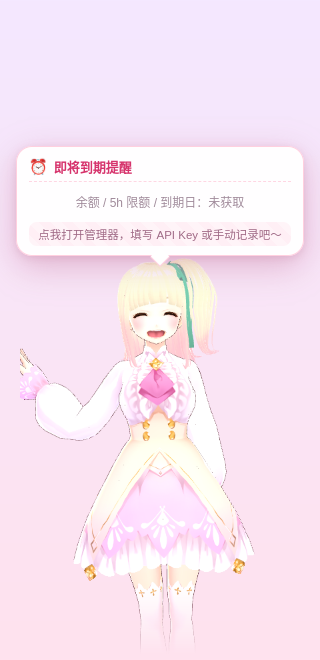
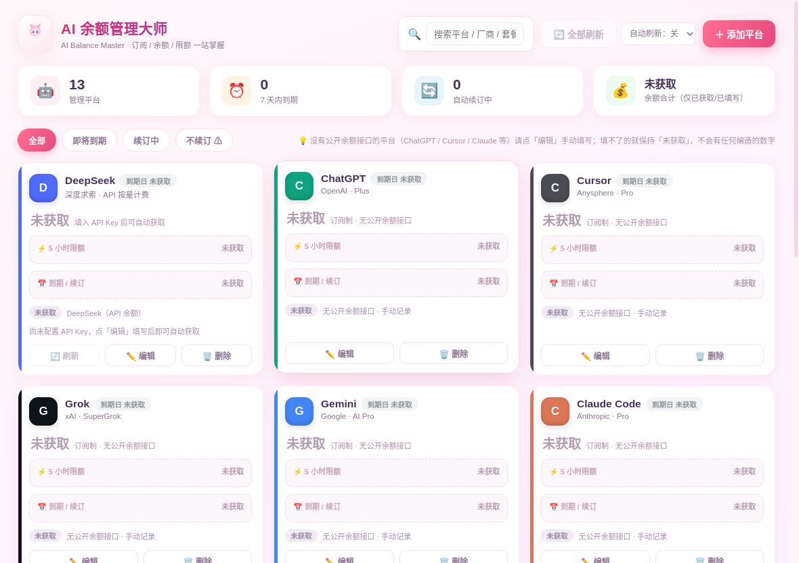
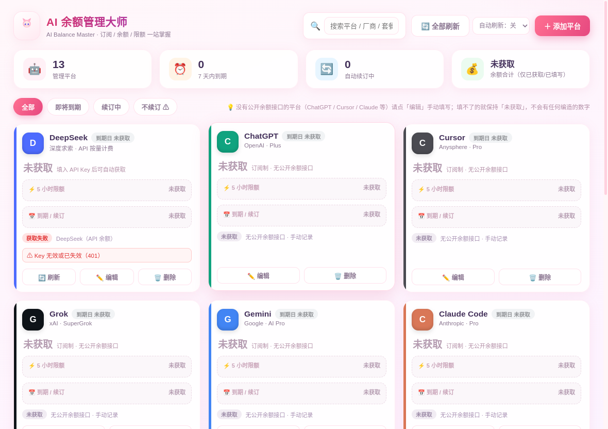
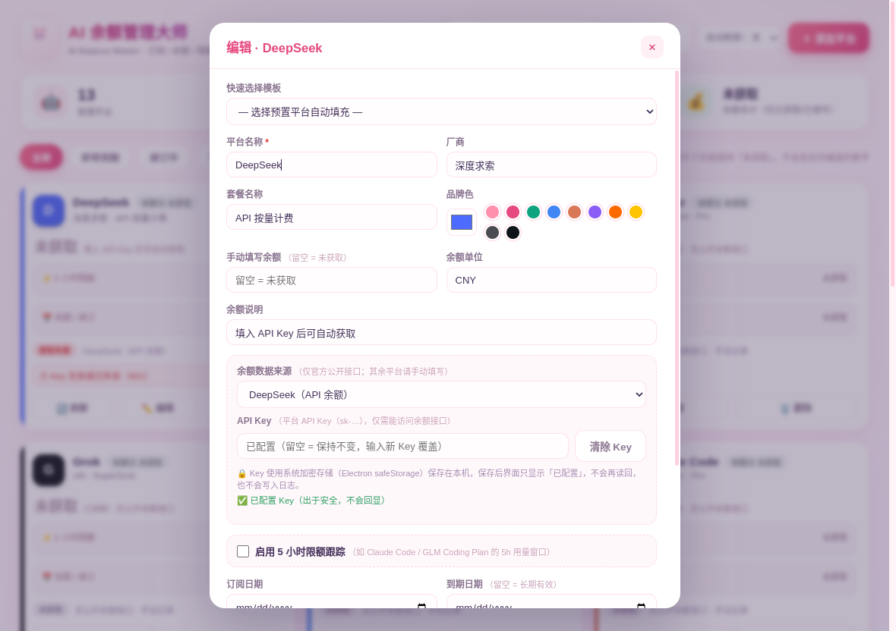

<div align="center">


# 🎀 AI余额管理大师

**到处薅来的额度、订阅了一堆的套餐——还剩多少、几时过期、会不会白白浪费？让一只二次元桌宠替你盯着。**

[](https://www.electronjs.org/)
[](https://github.com/pixiv/three-vrm)
[](#-快速开始)
[](LICENSE)
[](package.json)
[](#-隐私与安全)
[](#-贡献)


<sub>↑ 桌宠悬停：挥手 + 开心表情 + 提醒气泡（真实运行录制，此处为默认「未获取」状态）</sub>

</div>

---

## 😵 你是不是也这样？

- 🎁 **到处薅来的免费 AI**：这个平台送 5 美元、那个站送一堆 token，注册完就丢进收藏夹，**半个月后才想起来——早过期了**。
- 🧾 **订阅了好几个 AI，却记不住还剩多少**：ChatGPT、Cursor、Claude、Copilot、GLM、Kimi……每次想用都得挨个打开账单页翻。
- ⏳ **5 小时限额什么时候重置？** 写到一半被限流，才发现窗口刚用完；而另一个平台的窗口明明已经重置，额度却在白白空转。
- 🗑️ **很多 token 还没用就到期了**：按量充值的余额、赠送的代金券、套餐里的额度……过期即作废，一分钱都退不回来。
- 💸 **自动续订悄悄扣费**：忘了取消的订阅，下个月照扣；而你甚至不记得自己订过它。

> 痛点不是「没有额度」，而是**「不知道自己还有什么、什么时候没」**。

## 💡 它怎么解决

**AI余额管理大师** 把分散在各个平台的信息收拢到一个本地小工具里，再派一只桌宠常驻桌面当「提醒员」：

- 🐾 **桌宠在桌面上盯着**：鼠标悬停就弹出气泡，告诉你**最近要到期的 3 个平台**、剩余天数、余额、5 小时限额与重置倒计时；3 天内到期还会亮起红色警告。
- 🔌 **能自动查的绝不手填**：DeepSeek / Kimi / 硅基流动 / OpenRouter 填入 API Key，一键刷新余额（走官方文档公开的接口）。
- ✍️ **查不了的老老实实手填**：ChatGPT / Cursor / Claude 等没有公开余额接口——你可以手动记录到期日、续订状态、5 小时限额；**没填就显示「未获取」，绝不编造数字**。
- 🔒 **全本地、Key 加密**：数据只在你的电脑里，API Key 走系统加密存储。

## 📸 运行预览

> 所有截图都是在默认状态下真实运行本应用得到的（Linux 虚拟显示环境 + Electron 内置 `capturePage`，非 PS 合成）。桌宠是透明窗口，这里合成到一张粉紫渐变的「桌面示意背景」上。**没有任何编造的余额数字。**

| 桌宠悬停 | 桌宠待机 |
|:---:|:---:|
|  |  |
| 开心表情 + 挥手 + 提醒气泡；未录入数据时一律显示「未获取」 | 呼吸 / 摇摆 / 眨眼；头部与视线会跟随鼠标 |

**管理器（默认状态：所有未知值都是「未获取」）**



**获取失败的真实提示**（示例：用一个明显无效的**占位 Key** 请求 DeepSeek 官方接口，得到真实的 `401` → 卡片显示「获取失败 · Key 无效或已失效」）



**编辑平台：选择数据来源并保存 API Key（保存后只显示「已配置」，不会回显；截图里的「已配置」是上一张图所用的占位 Key）**



## ✨ 功能特性

### 🔌 真实数据，拿不到就「未获取」
- 默认只带 13 个平台名单（名称 / 厂商 / 套餐 / 品牌色），**余额、5 小时限额、订阅/到期日全部为空**，界面统一显示「未获取」。
- 主进程用 Node `fetch` 调用官方公开接口（无 CORS 限制）。每张卡片有 **🔄 刷新** 按钮，顶栏有 **全部刷新** 与 **自动刷新（关 / 15 / 30 / 60 分钟，默认关）**。
- 每个平台显示**获取状态**：`未获取` / `已获取` / `获取失败`，并带上次获取时间与错误原因（Key 无效、权限不足、网络错误、超时、限流…）。获取失败时若之前成功过，会保留上次的**真实**数值并标注「已过期」。

### 🎀 VRM 3D 二次元桌宠
- 透明置顶窗口里用 **three.js + @pixiv/three-vrm** 渲染 VRM 模型（内置 CC0 模型，见[素材致谢](#-素材致谢)），**全部离线、无 CDN**。
- 程序化动画：待机**呼吸 / 摇摆 / 眨眼**，手臂从 T-pose 自然放下；悬停时**开心表情 + 弹跳 + 挥手**；点击有反馈；**头部与视线跟随鼠标**（含窗口外的全局鼠标位置）。
- 交互：单击打开管理器 · 按住拖动（位置记忆）· 右键菜单 · **透明像素点击穿透**（只有角色身上才响应，不挡桌面）。
- 右键菜单可 **🖼 更换为你自己的 `.vrm`**、恢复默认、查看形象版权信息；模型加载失败会先退回内置形象，再不行显示原创 SVG 猫娘兜底。

### 📊 管理器
- 统计看板、平台卡片、搜索 / 筛选、增删改查、20+ 个平台模板；**5 小时限额**（总量 / 已用 / 重置倒计时，手动记录）、订阅周期进度、续订状态（是 / 否 / 未设置）。
- 托盘常驻、单实例、关闭窗口即隐藏到托盘。

## 🔗 支持自动获取余额的平台

只列出**已实现**并对照官方文档核对过的接口（接口来自各家官方 API 文档）：

| 平台 | 官方接口 | Key 要求 | 币种 | 备注 |
|---|---|---|---|---|
| DeepSeek | `GET https://api.deepseek.com/user/balance` | 平台 API Key | CNY / USD | 返回总额 / 充值 / 赠送；多币种时 CNY 优先 |
| Kimi / Moonshot（国内站） | `GET https://api.moonshot.cn/v1/users/me/balance` | 国内站 API Key | CNY | 返回可用 / 现金 / 代金券余额 |
| Kimi / Moonshot（国际站） | `GET https://api.moonshot.ai/v1/users/me/balance` | 国际站 API Key | USD | 国内站与国际站 Key **互不通用** |
| 硅基流动 SiliconFlow | `GET https://api.siliconflow.cn/v1/user/info` | API Key | CNY（按国内站假设） | 使用 `totalBalance`，并展示充值 / 赠送拆分 |
| OpenRouter | `GET https://openrouter.ai/api/v1/credits` | **必须是 Management Key** | USD（1 credit = 1 美元） | 余额 = `total_credits - total_usage`；普通 Key 会返回 403 |

**无公开余额接口、只能手动记录的平台**：ChatGPT、Cursor、Claude Code、Grok、Gemini、GitHub Copilot、GLM Coding Plan、LongCat、Trae、Qoder、OpenCode、Cline、通义千问、豆包、Windsurf、纳米 AI 等模板。它们的卡片备注为「订阅制 · 无公开余额接口」或「手动填写」，你填了才显示，没填就是「未获取」。

> 本项目**不使用任何未公开/未文档化接口，也不会读取其他应用的本地凭据文件**。官方接口若有调整，请提 Issue。

## 🚀 快速开始

环境：**Windows 10/11**、Node.js ≥ 18。

### 方式一：双击启动（推荐）
```
双击 启动桌宠.bat        （或 start.bat）
```
首次运行会自动使用国内镜像安装依赖，之后直接启动。

### 方式二：命令行
```bash
git clone <你的仓库地址>
cd AI_time
npm install        # 国内网络可加：--registry=https://registry.npmmirror.com，并设置 ELECTRON_MIRROR=https://npmmirror.com/mirrors/electron/
npm start
npx electron . --show-manager     # 启动并同时打开管理器
```

> ⚠️ 若在 VSCode / Cursor 等 Electron 系 IDE 的终端里启动失败（报 `ipcMain` undefined），是 `ELECTRON_RUN_AS_NODE=1` 被注入所致：先执行 `Remove-Item Env:ELECTRON_RUN_AS_NODE`（PowerShell）或 `set ELECTRON_RUN_AS_NODE=`（CMD）。使用 `启动桌宠.bat` 无此问题。

### 使用小抄

| 操作 | 效果 |
|---|---|
| 鼠标悬停桌宠 | 挥手 + 开心表情 + 展开最近 3 个平台的气泡 |
| 单击桌宠 | 打开 / 聚焦管理器 |
| 按住拖动 | 移动位置（自动记忆） |
| 右键桌宠 | 管理器 / 刷新全部余额 / 更换 VRM 形象 / 形象版权信息 / 退出 |
| 管理器「编辑」 | 选择「余额数据来源」并填入 API Key，或手动填余额 / 5h 限额 / 到期日 |
| 托盘图标 | 双击打开管理器；菜单里可刷新全部、显示 / 隐藏桌宠 |

## 🔒 隐私与安全

- **本地优先**：数据保存在 `%APPDATA%\AI余额管理大师\ai-balances.json`，没有账号体系、没有遥测、没有自己的服务器。程序**只会**在你点刷新（或开启自动刷新）时，用你配置的 Key 访问上表中的官方接口。
- **API Key 加密保存**：使用 Electron `safeStorage`（Windows 上为 DPAPI，绑定当前系统用户）加密后存放在单独的 `ai-keys.json`。若系统没有可用的加密存储，**程序会拒绝保存并提示你，绝不降级为明文**。
- **Key 只进不出**：保存之后渲染进程（界面）永远读不到 Key，只会看到「已配置」；Key 不写日志、错误提示里也不含 Key。删除平台时对应的 Key 同步删除。
- 渲染进程开启 `contextIsolation`、关闭 `nodeIntegration`，并带有内容安全策略（CSP）。
- 建议：给 Key 单独创建权限最小的 Key（OpenRouter 的 Management Key 权限较大，请妥善保管，不用时可清除）。

### 📦 数据迁移（v1.0 → v1.1）
旧版本把示例数据（含**编造的**余额 / 额度 / 到期日）写进了数据文件。新版本启动时若发现数据文件**没有 `version` 字段**，会：
1. 把旧文件备份为 `%APPDATA%\AI余额管理大师\ai-balances.backup-v1.json`（不会覆盖已有备份）；
2. 重新生成「未获取」的干净默认数据（仅保留桌宠位置）。

如需找回自己手填过的内容，请从备份文件里手动取回。

## 📁 项目结构

```
AI_time/
├── main.js               # 主进程：窗口 / 托盘 / 数据持久化与迁移 / safeStorage 密钥 / 余额刷新 / 全局鼠标
├── preload.js            # 预加载：受限 IPC 桥（Key 只写不读）
├── lib/
│   ├── providers.js      # 官方余额接口：端点 + 响应解析 + 错误映射（可单测）
│   └── data.js           # 默认数据 / 迁移 / 合并规则（可单测）
├── src/
│   ├── pet.html/css/js   # 桌宠：VRM 画布、气泡、拖动、像素级点击穿透、SVG 兜底
│   ├── manager.*         # 管理器
│   ├── shared.js         # 「未获取」显示逻辑（两个窗口共用）
│   ├── vrm-src/          # VRM 渲染器源码（three.js + three-vrm）
│   ├── vendor/           # 打包后的渲染器（已提交，运行时无需联网）
│   └── models/           # CC0 VRM 模型与许可证
├── tests/                # node:test（mock fetch，不需要真实 Key）
├── tools/                # 模型瘦身 / 封面生成 / 截图合成脚本
├── scripts/              # 打包渲染器、无头运行、文档截图
├── docs/                 # banner.svg 与截图
├── 启动桌宠.bat / start.bat
├── ASSETS_LICENSE.md  THIRD_PARTY_LICENSES.md  LICENSE
└── package.json
```

## 🛠 开发

```bash
npm test               # 解析逻辑 / 迁移 / 数据合并的单元测试（mock fetch）
npm run build:vrm      # 修改 src/vrm-src/ 后重新打包渲染器
```

无显示器环境（CI / Linux 虚拟显示）运行与生成截图：

```bash
AITIME_USER_DATA=/tmp/aitime-shots xvfb-run -a -s "-screen 0 1600x1000x24" npx electron scripts/capture-docs.js
python3 tools/make-shots.py      # 合成 README 配图与 GIF（需要 Pillow）
```

## 🗺 路线图

- [ ] 评估更多**官方文档公开**的余额 / 用量接口并加入（欢迎在 Issue 里附官方文档链接）
- [ ] 到期 / 低额度的系统通知
- [ ] 数据导入 / 导出（含从备份恢复）
- [ ] 打包安装程序（electron-builder）与开机自启选项
- [ ] 更多桌宠动作（点击、久未交互）、内置多个 CC0 形象可切换
- [ ] 英文界面
- [ ] macOS / Linux 适配与测试（目前仅面向 Windows）

## 🤝 贡献

欢迎 Issue 与 PR：
- 新增某平台的余额接口时，请附**官方文档链接**与返回结构，并在 `tests/providers.test.js` 里补 mock 测试；不接受未公开 / 逆向的接口。
- 提交前运行 `npm test`；界面改动请附截图。
- 新增素材请确保**许可证明确允许再分发**，并更新 `ASSETS_LICENSE.md`。

## 📄 许可证

代码与原创素材以 [MIT](LICENSE) 许可发布。第三方素材 / 代码遵循各自许可证（见下）。

## 💖 素材致谢

- **桌宠模型**：*Victoria Rubin*（VRoid 示例 β Ver AvatarSample_4），作者 **VRoid Project（pixiv Inc.）**，许可 **CC0 1.0**；经 [OpenGameArt](https://opengameart.org/content/vroid-studio-cc0-models) 取得，本项目仅缩小了内嵌贴图。详见 [ASSETS_LICENSE.md](ASSETS_LICENSE.md)。
- **渲染**：[three.js](https://threejs.org/)（MIT）· [@pixiv/three-vrm](https://github.com/pixiv/three-vrm)（MIT）。
- **封面字体**：Noto Sans CJK SC（SIL OFL 1.1，已转为矢量路径）。
- 框架：[Electron](https://www.electronjs.org/)（MIT）。

<div align="center"><sub>如果它帮你少浪费了哪怕一次额度，欢迎点个 ⭐</sub></div>
